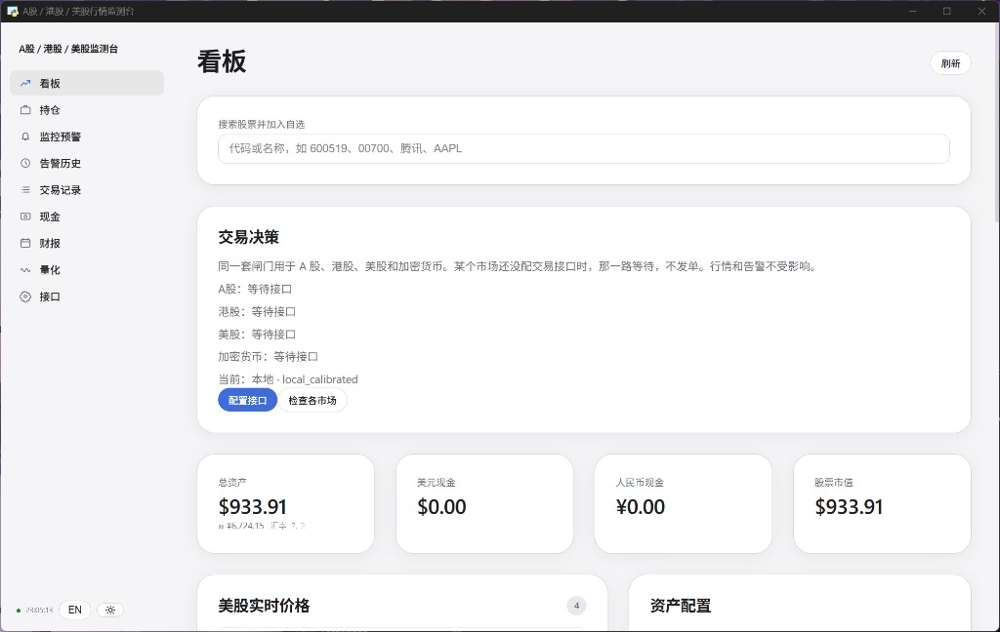
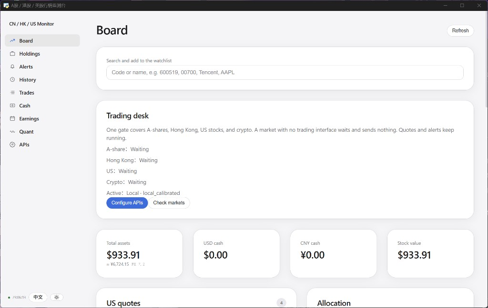
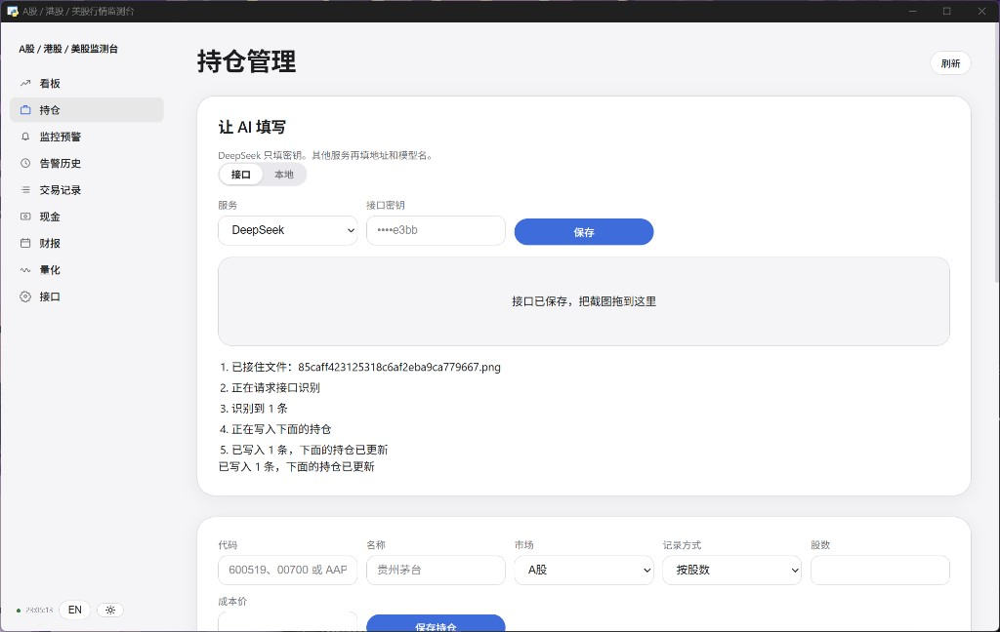
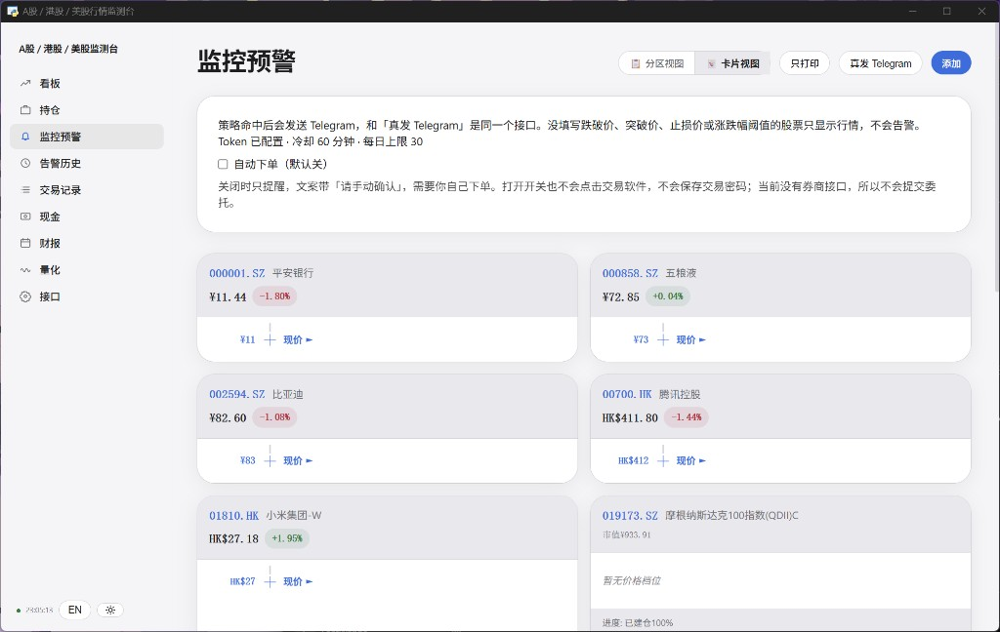
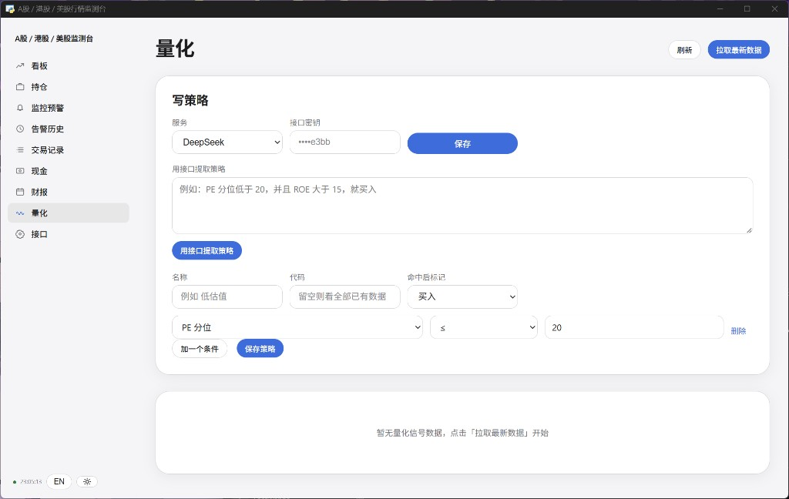
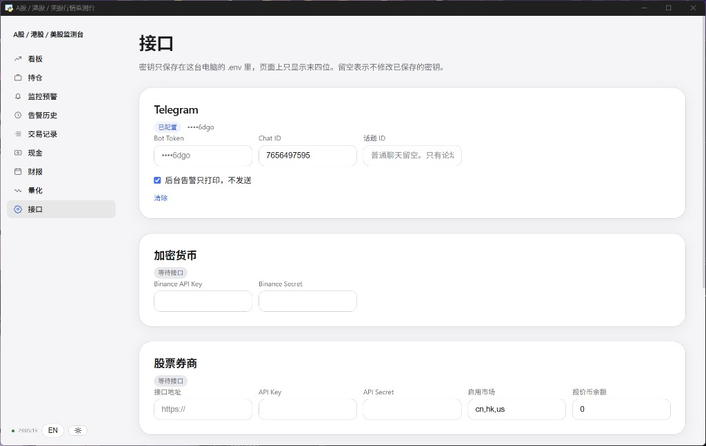

# A-Share, Hong Kong, and US Market Monitor

[中文说明](README.md)

A local desktop window for A-shares, Hong Kong stocks, US stocks, and crypto. The watchlist, quotes, holdings, alerts, quant rules, and trading APIs live in one app. Keys are written to the local `.env`. The page shows only the last four characters. A market with no trading interface waits and sends no order. The app does not click a trading client and does not store a trading-app password.

The sidebar can switch between 中文 and English, and the theme can follow the system or stay light or dark.

## Pages

### Board

Search by code or name and add the symbol to the watchlist. The trading desk shows whether each market has an interface, and which decision model is active. Below that are total assets, cash, and stock value. Total assets are in US dollars, with a renminbi equivalent underneath. Quotes are grouped into US, Hong Kong, and A-shares. A row opens the chart.



The same page in English:



### Holdings

A position can be stored as a share count or as an amount of money. Funds without a share count, and fractional shares, both fit. Saving the same code again replaces that position. Cash is left unchanged.

**Let AI fill this** reads a broker screenshot. DeepSeek needs only a key. Another provider also needs a base URL and a model name. A model server already running on this computer can be used instead. Drop an image on the window, or click the area and choose a file. The steps are listed while it runs, and the rows it finds are written into the holdings list.

The summary cards use the same currency as the rows. A book that is only renminbi shows ¥. When US dollars or Hong Kong dollars are mixed in, the summary is converted to renminbi and a US-dollar equivalent is shown on the line below.



### Alerts

A symbol with no break-below, break-above, stop, or percent rule only shows a quote. It does not alert. A hit is sent through Telegram. Zone view and card view are both available. **Print only** does not call Telegram. **Send to Telegram** is the live test.

Auto-order is off by default. While it is off, a hit is only a reminder and the text says to confirm by hand. Turning it on still does not click a trading app and does not save a trading password. With no broker interface for that market, no order is submitted.



### Quant

Write a rule with a name, a symbol, the mark to apply on a hit, and conditions such as PE percentile or ROE. Or paste a paragraph and let the configured API turn it into conditions. If the signal list is empty, use **Pull latest data**.



### APIs

Telegram, crypto, and the stock broker each have their own card. A saved secret shows its last four characters. Leaving a field blank keeps the saved value. A market that is still empty stays on “waiting for an interface.” The decision model can be a server already running on this computer, or a separate API.



The sidebar also has alert history, trades, cash, and earnings. Cash is split into US-dollar and renminbi accounts. Trades can be exported as CSV.

## What it does

- **Watchlist.** On the board, search `600519`, 茅台, `00700`, 腾讯, or `AAPL`, then add it. `600519` is stored as `600519.SS`, `000001` as `000001.SZ`, `00700` or `700` as `00700.HK`. US tickers stay as letters. Adding a symbol does not create an alert.
- **Quotes.** A-shares come from Sina, then Tencent if Sina fails. Hong Kong, US names, and the index cards come from Eastmoney. The index cards are the S&P 500, Nasdaq, Dow Jones, and the US Dollar Index. The refresh interval is `monitor.interval_active` in `config.yaml`, in seconds.
- **Holdings.** Share counts can be fractional. An amount position does not need a share count. Screenshot rows and hand-entered rows sit in the same list and can be edited or removed.
- **Alerts.** The same rule waits out a cooldown, 60 minutes by default. The daily cap defaults to 30. Both are in `config.yaml`: `alert.cooldown` is in seconds, and `alert.max_per_day` is the cap. With `ALERT_DRY_RUN=true`, a background hit is only printed. **Send to Telegram** on the alerts page still calls the Bot API.
- **Decisions.** All four markets share one gate. An unconfigured market waits. When the interface is filled in, a decision that passes the gate is sent through that market’s API. If the local model server is down, the status line shows the backend that is actually running.
- **Window.** The left sidebar switches pages. Language and theme sit at the bottom of the sidebar.

The first launch includes a sample A-share list (Kweichow Moutai, Wuliangye, Ping An, China Merchants Bank, Ping An Bank, CATL, BYD, Zijin Mining, CSI 300 ETF) plus Tencent, Alibaba, and Xiaomi.

An alert looks like this:

```
[信号] 600519 贵州茅台 现价1688.00 涨跌+1.23% | 规则:pct_change>=3 | 分组:A股 | 请手动确认 | 时间:2026-10-18 23:41:00
```

## Install

Windows, Python 3.11 or newer, and Node.js.

```bat
copy .env.example .env
copy config.example.yaml config.yaml
```

Fill in Telegram in `.env`. Do not paste the token into chat, and do not commit `.env`:

```
TELEGRAM_BOT_TOKEN=
TELEGRAM_CHAT_ID=
TELEGRAM_THREAD_ID=
ALERT_DRY_RUN=true
TRADING_AUTO_ORDER=false
```

Leave `TELEGRAM_THREAD_ID` empty for a normal chat. It is only for a forum topic.

Create the bot with `@BotFather`. After you send it one message, a personal chat id is available from `@userinfobot`. A group id is usually negative. The same fields can be saved on the APIs page. They are stored in the local `.env`.

## Open

The desktop shortcut **A股监测台** opens its own window. It does not open a browser tab.

The first time, if dependencies are missing, double-click `start.bat` in the project folder, then open the shortcut again.

Dropping a screenshot works in that desktop window. Recognition uses the API or local model configured under **Let AI fill this**.
